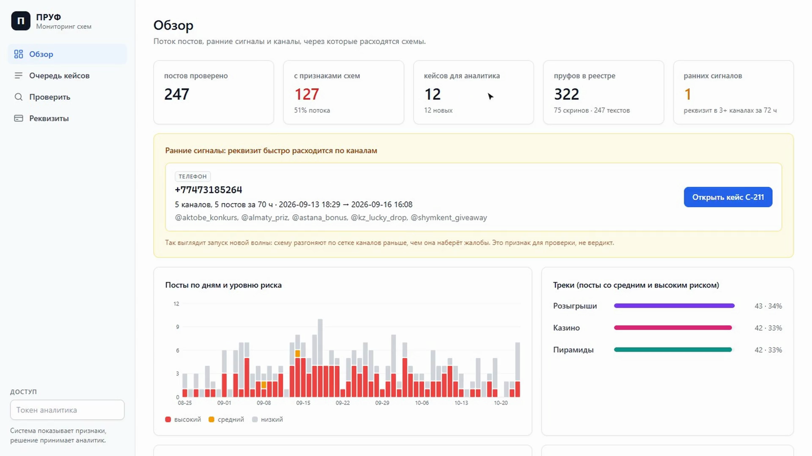
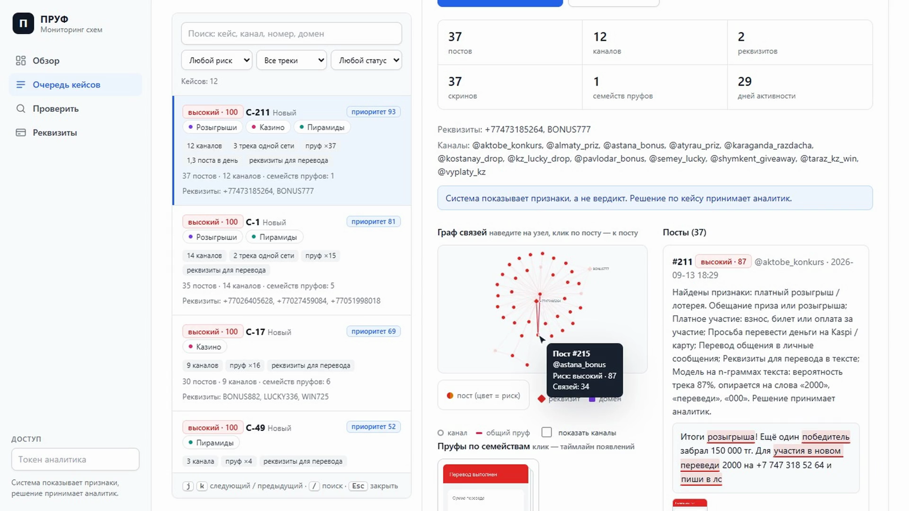
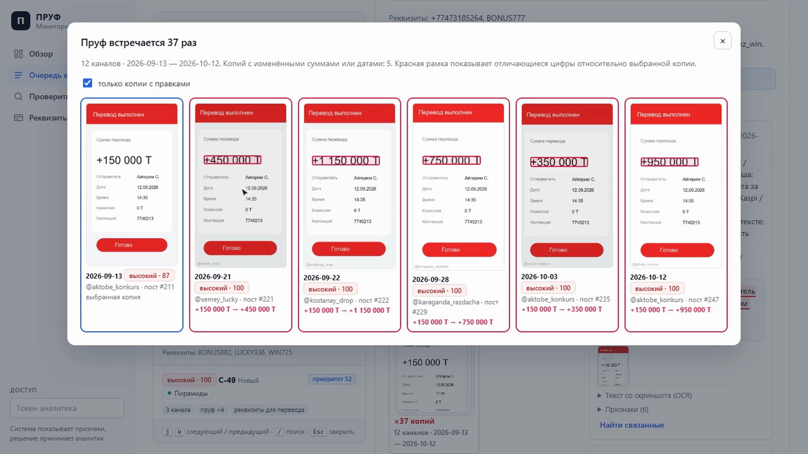
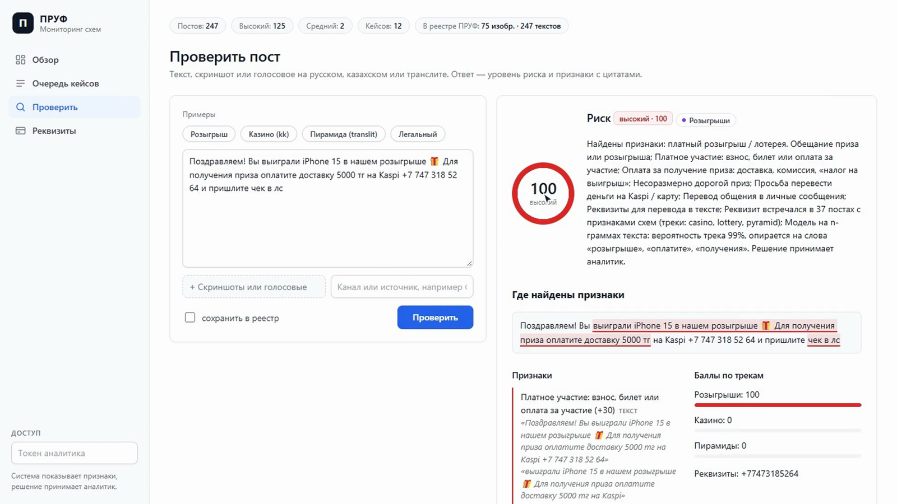
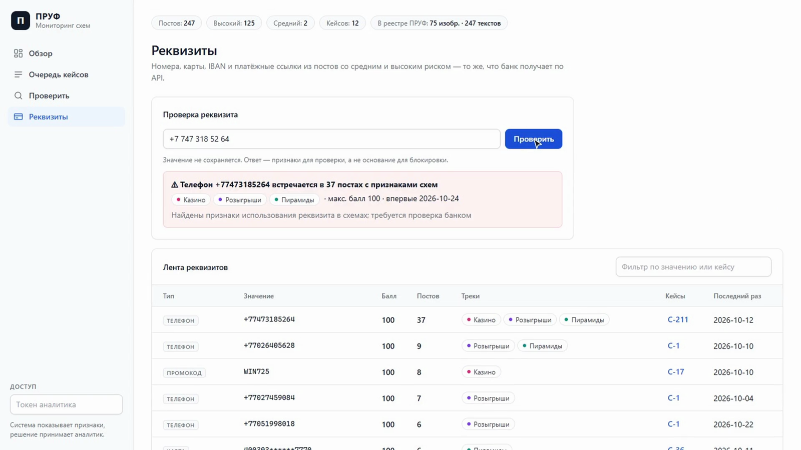

# ПРУФ · SafeNet KZ

**Рабочее место аналитика финансовой безопасности: находит в соцсетях и мессенджерах Казахстана признаки платных розыгрышей, скрытой рекламы онлайн-казино и финансовых пирамид — и доказывает их повторно использованными «пруфами».**

Прототип для хакатона SafeNet KZ (Шымкент, 2026). Система не выносит вердикт: она показывает **признаки** с цитатами из текста и уровень риска (низкий / средний / высокий), а решение принимает аналитик.



**Демо-видео (3 минуты, с озвучкой):** [docs/demo/pruf-demo-voice.mp4](docs/demo/pruf-demo-voice.mp4) · [без звука](docs/demo/pruf-demo.mp4) · [сценарий озвучки](docs/demo/voiceover.md)

**Презентация (11 слайдов, PDF):** [docs/pitch/pruf-pitch.pdf](docs/pitch/pruf-pitch.pdf) · **Живой сервер:** https://pruf-bba7.onrender.com (вход по токену аналитика; бесплатный план без OCR скриншотов, после простоя просыпается около минуты)

## Зачем

Мошенники меняют слова, но годами гоняют одни и те же «пруфы»: скрин «выплаты», голосовое, номер Kaspi, домен. ПРУФ находит признаки схемы в каждом сообщении и связывает сообщения через общие пруфы и реквизиты в кейсы — сразу на трёх треках:

| Трек | Что ищем |
|---|---|
| Розыгрыши под контролем | платное участие, «оплатите доставку приза», фальшивые розыгрыши банков и брендов |
| Скрытая игра | реклама казино и ставок под видом «игры с выводом», зеркала, промокоды, crash-игры |
| Стоп-пирамида | «удвоим за неделю», % в день, доход за приглашённых, «касса взаимопомощи» |

## Что умеет

- **Детектор признаков** для текста, скриншотов (OCR), голосовых (Whisper, если подключён) и ссылок; русский, казахский, транслит и маскировка вроде «к@зино». Правила с цитатами + ML-модель + Claude для спорных случаев (только с дословными цитатами; его «это легально» балл не снижает).
- **QR-коды на картинках**: ссылка Kaspi Pay, домен казино или канал, спрятанные в QR на афише или скрине, становятся реквизитом и ссылкой поста. Два поста с одним QR связываются в кейс, даже если тексты и картинки разные.
- **Реестр пруфов**: почти-дубликаты изображений (PDQ + OCR), текстов (MinHash LSH), голосовых, ссылок и реквизитов. Таймлайн появлений и дифф сумм и дат между копиями одного скрина.
- **Граф кейсов**: посты, каналы, реквизиты, пруфы и домены; приоритет кейса, пакет доказательств ZIP с SHA-256 и временем UTC, отчёт для печати и PDF.
- **Ранние сигналы**: реквизит разошёлся по 3+ каналам за 72 часа — так выглядит запуск новой волны.
- **Для банка**: лента засвеченных реквизитов и проверка номера (в дашборде и по API).
- **Telegram-бот**: пересылаете пост или скрин — получаете уровень риска (бот ничего не сохраняет и не раскрывает базу).
- **Агент-Разведчик**: из одной жалобы сам находит связанные публичные каналы по ссылкам, репостам, упоминаниям, общим номерам Kaspi и доменам. Только читает, никому не пишет.
- **Расширение ПРУФ Sentinel** (Chrome): плашка над подозрительным постом в Telegram Web и Instagram, страница-предупреждение вместо сайта из чёрного списка, проверка номера из контекстного меню. Текст постов не уходит из браузера.

| Кейс: граф связей и посты с подсветкой | Один скрин, 37 копий, 5 с перерисованной суммой |
|---|---|
|  |  |
| **Проверка поста: риск, признаки, цитаты** | **Реквизиты: проверка номера банком** |
|  |  |

## Качество

**Главное — реальные посты.** Свежий набор открытых каналов Казахстана, которых система раньше не видела,
размечен двумя независимыми разметчиками (каппа 0,95), измерен один раз и только потом ушёл в обучение.

| Свежие реальные посты, правила + ML без Claude | Precision | Recall | Ложные тревоги |
|---|---|---|---|
| **real_v4** (416 постов, 24 новых канала), модель обучена с реальными постами real_v1–v3 | **0,92** | **0,83** | **0,031** |
| real_v4, модель без реальных постов (так было на сервере до `models/prod`) | 0,86 | 0,77 | 0,055 |
| real_v4, только правила | 0,90 | 0,56 | 0,027 |
| real_v3 (418 постов, 24 новых канала), модель без реальных постов | 0,88 | 0,57 | 0,040 |

Модель на сервере (`models/prod`) обучена на всех четырёх реальных наборах, 1 639 постов; честного замера именно её ещё нет —
нужен следующий свежий набор real_v5. Ближайший честный замер — первая строка: модель с real_v1–v3 на невиданном real_v4,
где примерно каждая шестая схема ещё проходит. Сами посты в git не кладём; `python scripts/real_manifest.py` там, где они лежат, пишет `eval/real_manifest.json` —
хэши, число постов, метки и языки каждого набора без текстов. По `--verify` владелец данных или проверяющий с доступом
убеждается, что замер сделан на тех же данных.

**Рукописные слепые наборы** (200 постов: ru, kk, mix, транслит; пишет отдельный агент без доступа к коду) —
трудные пограничные случаи: бесплатные конкурсы, предупреждения, вакансии, личные переводы.

| Набор, правила + ML без Claude | Precision | Recall | Ложные тревоги (FPR) |
|---|---|---|---|
| v12 (95% интервалы) | 0,88 (0,80–0,93) | 0,88 (0,80–0,93) | 0,12 (0,07–0,20) |
| v11 | 0,94 | 0,85 | 0,05 |
| Код до раундов улучшений (для сравнения, набор v10) | 0,78 | 0,25 | 0,07 |

Балл 0–100 — сумма весов признаков, а не вероятность: «70» значит «несколько сильных признаков схемы»,
а не «70% мошенничества». Пороги уровней подобраны по замерам выше.

Claude в спорной зоне (балл 20–74), живой прогон Sonnet на наборе v10: recall 0,78 → 0,87, ложные тревоги 0,05 → 0,04 (`scripts/llm_sim.py --live`). Интервалы, все наборы и история замеров — в [docs/metrics.md](docs/metrics.md); как считается балл и все признаки — в [docs/methodology.md](docs/methodology.md).

## Быстрый старт

Нужен Python 3.11+ (тесты проходят на 3.11, 3.12 и 3.13).

```bash
python -m venv .venv && source .venv/bin/activate      # Windows: .venv\Scripts\activate
pip install -r requirements-dev.txt

# демо-данные: фон + кейс C-211 (один скрин выплаты, 37 появлений, 5 правок суммы,
# один номер Kaspi в розыгрыше, казино и пирамиде); модель обучится сама, если её нет
PRUF_DEV_MODE=1 PRUF_DATA_DIR=data/demo python scripts/seed_demo.py --reset

# сервер (строго один воркер: индексы в памяти процесса)
PRUF_DEV_MODE=1 PRUF_DATA_DIR=data/demo uvicorn pruf.api.app:create_app --factory --port 8000
```

<details>
<summary>То же в PowerShell (Windows)</summary>

```powershell
python -m venv .venv; .venv\Scripts\python -m pip install -r requirements-dev.txt
$env:PRUF_DEV_MODE="1"; $env:PRUF_DATA_DIR="data/demo"
.venv\Scripts\python scripts\seed_demo.py --reset
.venv\Scripts\python -m uvicorn pruf.api.app:create_app --factory --host 127.0.0.1 --port 8000
```

Открывайте `http://127.0.0.1:8000`: на части Windows-машин `localhost` уходит в IPv6 и не отвечает.
</details>

**Демо-путь:** Обзор → ранний сигнал по номеру +77473185264 → «Открыть кейс C-211» (три трека, 12 каналов) → граф связей → карточка «×37 копий» → таймлайн, флажок «только копии с правками» → «Отчёт для печати». Вкладка «Проверить» — готовые примеры (ru, kk, транслит, легальный), «Реквизиты» — лента для банка и проверка номера.

## Проверка разметки человеком

Наборы размечали два независимых ИИ-разметчика (каппа около 0,95). Чтобы подтвердить разметку экспертом-человеком:
`python scripts/human_audit.py sample --n 120 --out audit/round1` даёт слепую страницу `audit/round1.html`
(поровну по классам, без меток ИИ, работает офлайн и с телефона, ответы сохраняются файлом) и ключ
`audit/round1.key.json`. Ответ эксперта: `python scripts/human_audit.py score --key audit/round1.key.json
--answers pruf-audit-answers.json --report docs/audit.md` — каппа Коэна «схема / не схема» и по четырём классам,
матрица ошибок и список расхождений с комментариями эксперта.

## Дообучение на решениях аналитика

Раз в неделю: `PRUF_DATA_DIR=data python scripts/retrain_feedback.py` — отчёт, `--apply` — замена модели.
Посты подтверждённых кейсов становятся примерами своего трека, отклонённых — легальными. Претендент заменяет
текущую модель, только если на отложенной четверти решений ни он, ни сама модель без правил не ошибаются чаще,
а на всех dev-наборах нет регрессии: одно ошибочное решение аналитика не испортит модель. Прежняя модель
остаётся рядом (`.prev.joblib`). Словарь сам не меняется: признаки, которые чаще всего оспаривают в боте,
выводятся в отчёте для ручного ревью.

## Охват, пилот и защита

- [docs/analysis.md](docs/analysis.md) — полный анализ проекта: что и как устроено, качество, сильные и слабые стороны, что дальше.
- [docs/coverage.md](docs/coverage.md) — что ПРУФ собирает сам, что приходит от людей и чего не видит.
- [docs/pilot/bank.md](docs/pilot/bank.md) — пилот с банком: API в обе стороны, метрики, шаблон письма о намерениях.
  Банк сообщает исход по реквизиту: `POST /api/v1/bank/feedback` (`fraud_confirmed` / `legit_client`);
  аналитик видит это во вкладке «Реквизиты», другие банки — в ответе проверки номера без названий банков.
- [docs/defense.md](docs/defense.md) — трудные вопросы жюри и честные ответы.

## Деплой

**Docker** (один контейнер, демо-данные создаются при первом запуске за несколько минут):

```bash
docker build -t pruf .
docker run -p 8000:8000 -e PRUF_ANALYST_TOKEN=demo:$(openssl rand -hex 16) \
  -e PRUF_HMAC_KEY=$(openssl rand -hex 32) -e ANTHROPIC_API_KEY=... pruf
```

**Перед питчем.** На бесплатном Render сервер засыпает, а после пробуждения 3–5 минут заново создаёт демо-данные.
За 10 минут до выступления: `PRUF_TOKEN=... python scripts/warmup.py --keep-awake 120` — разбудит, дождётся кейса C-211,
пройдёт весь демо-путь с временем каждого шага и будет держать сервер бодрым 2 часа. То же без ноутбука:
Actions → warmup → Run workflow (нужен секрет репозитория `PRUF_TOKEN`).

**Модель для прода.** Реальные посты (`eval/real_v*.jsonl`) в git не попадают, поэтому без них образ обучает модель
только на синтетике и ручных наборах. Обученная с реальными постами модель кладётся в `models/prod` командой
`python scripts/train.py --publish` там, где они лежат; сборка ставит её, если сошлись SHA-256 и версия scikit-learn
([models/prod/README.md](models/prod/README.md)).

**Render:** New → Blueprint → этот репозиторий. [`render.yaml`](render.yaml) сам сгенерирует токен аналитика и HMAC-ключ; `ANTHROPIC_API_KEY` введите в настройках сервиса (без него всё работает, только без Claude).

Вне dev-режима дашборд просит токен аналитика (поле «Доступ» внизу меню) в формате `имя:токен` из `PRUF_ANALYST_TOKEN` — вводите только часть после двоеточия, если в токене есть имя.

## Настройки

| Переменная | Что задаёт |
|---|---|
| `PRUF_DATA_DIR` | каталог базы и файлов (по умолчанию `data/`) |
| `PRUF_DEV_MODE=1` | режим разработки: токены не обязательны, случайный HMAC-ключ. Не для публичного доступа |
| `PRUF_ANALYST_TOKEN` | токены аналитиков через запятую, формат `имя:токен` |
| `PRUF_BANK_TOKENS` | токены банков, формат `halyk:токен,...` |
| `PRUF_HMAC_KEY` | ключ сопоставления номеров карт (обязателен вне dev-режима) |
| `ANTHROPIC_API_KEY` | включает Claude для спорных случаев |
| `PRUF_LLM_MODEL` | модель Claude (по умолчанию `claude-sonnet-5-5`) |
| `PRUF_LLM_DAILY_BUDGET` | максимум вызовов Claude в сутки (по умолчанию 5000; для демо хватает 300) |
| `TELEGRAM_BOT_TOKEN`, `PRUF_TELEGRAM_SECRET` | бот: токен и секрет вебхука |
| `PRUF_RESOLVE_LINKS=1` | раскрывать сокращённые ссылки (с защитой от внутренних адресов) |
| `PRUF_STATE_URL` | где хранить решения людей между перезапусками: `postgresql://…` или `file:/путь`. Статусы кейсов, решения по спискам, жалобы, отметки бота, исходы банков и аудит сохраняются снимком через 5 с после изменения и при остановке, при старте восстанавливаются. Пока снимок не прочитан, запись выключена: недоступная база не затрёт решения демо-состоянием. Состояние видно в `GET /api/v1/stats` → `state` |
| `PRUF_QR=0` | выключить чтение QR-кодов на картинках (по умолчанию включено, около 24 МБ памяти, работает и при `PRUF_OCR=0`) |
| `PRUF_OCR=0` | выключить OCR скриншотов (хостинг с 512 МБ: OCR поднимает память до 540–660 МБ); сравнение картинок остаётся |
| `PRUF_MAX_UPLOAD_BYTES`, `PRUF_RATE_LIMIT` | лимит файла (8 МБ) и запросов в минуту (120) |
| `PRUF_EXTENSION_TOKENS` | токены расширения ПРУФ Sentinel, формат `chrome:токен,...`: только `/inspect` и чёрный список |
| `TG_API_ID`, `TG_API_HASH`, `PRUF_SCOUT_SESSION` | разведчик в живом Telegram: ключи с my.telegram.org и файл сессии (по умолчанию `data/scout.session`) |

## API

Все ответы в формате `{success, data, error, meta}`, токен в `Authorization: Bearer …`.

| Метод | Назначение |
|---|---|
| `POST /api/v1/analyze/text` | проверка текста (`store: false` ничего не сохраняет) |
| `POST /api/v1/analyze` | приём поста с файлами (multipart) |
| `GET /api/v1/cases`, `GET/PATCH /api/v1/cases/{key}` | очередь и карточка кейса, статус аналитика |
| `GET /api/v1/cases/{key}/export` | пакет доказательств ZIP |
| `GET /api/v1/artifacts/{id}/timeline` | все появления пруфа с диффом сумм и дат |
| `GET /api/v1/posts/{id}/related` | связанные посты |
| `GET /api/v1/bank/requisites`, `POST /api/v1/bank/check` | лента реквизитов и проверка номера для банка |
| `GET /api/v1/overview` | динамика по дням, треки, топ-каналы, статусы кейсов, ранние сигналы |
| `GET /api/v1/stats`, `GET /api/v1/health` | статистика, что работает, здоровье |
| `GET /api/v1/scout` | каналы и связи, найденные разведчиком |
| `GET /api/v1/networks` | сети каналов с общими реквизитами и ключевой реквизит каждой (что заблокировать первым) |
| `POST /api/v1/inspect`, `GET /api/v1/blacklist/domains` | для расширения: риск по реквизитам, ссылкам, хэшу и признакам (без текста) и чёрный список доменов |
| `POST /api/v1/reports`, `GET /api/v1/reports` | жалоба «Сообщить в ПРУФ» из расширения и реквизиты из жалоб для аналитика |
| `GET /api/v1/bot/feedback?days=30` | признаки, которые пользователи бота оспорили кнопкой «Это не мошенничество», с долей споров |
| `POST /api/v1/bank/feedback`, `GET /api/v1/bank/feedback` | исход по реквизиту от банка (токен банка) и список исходов для аналитика |

## Telegram-бот

```bash
TELEGRAM_BOT_TOKEN=... PRUF_DATA_DIR=data/demo PRUF_DEV_MODE=1 python -m pruf.bot.telegram
```

Под ответом со средним и высоким риском бот ставит кнопку «Это не мошенничество». Нажатие сохраняет только
сработавшие признаки, уровень и балл (без текста, цитат и реквизитов; кто нажал — HMAC с месячной эпохой).
Аналитик видит во вкладке «Проверить» таблицу «Оспоренные признаки из бота»: сколько людей оспорили признак
и какая это доля от всех его показов за 30 дней. Так видно, какое правило словаря чаще всего ошибается.

Или вебхук: задайте `TELEGRAM_BOT_TOKEN` и `PRUF_TELEGRAM_SECRET` (не короче 32 символов) и зарегистрируйте `https://<хост>/api/v1/telegram/webhook` через `setWebhook` с `secret_token`. Бот отвечает только в личных чатах, каналы, суммы и счётчики из базы не раскрывает.

## Агент-Разведчик

Разведчик начинает с известных скам-каналов (по умолчанию каналы постов высокого риска из реестра) и идёт снежным комом:
ссылки `t.me/…`, репосты, `@упоминания`, поиск по найденным номерам Kaspi, IBAN и доменам, поиск по ключевым фразам
(ru, kk, латиница). Каждый канал проверяется детектором ПРУФ, посты попадают в реестр (`source=scout`), и дальше
разведчик идёт только от каналов с высоким риском. Очередь приоритетная: общий реквизит и репост раньше упоминания,
свежие и быстрорастущие каналы раньше старых; чистые каналы перепроверяются раз в неделю, рискованные раз в 6 часов.
Claude разведчик не зовёт (флаг `--llm` включает), запросы к источнику ограничены по частоте и числу.

```bash
# офлайн-демо без аккаунта Telegram: из одной «жалобы» 15 связанных каналов и 4 общих номера Kaspi
PRUF_DEV_MODE=1 PRUF_DATA_DIR=data/demo python -m pruf.scout --demo --no-keywords
```

Результат виден во вкладке «Разведка» дашборда и в `GET /api/v1/scout`; посты разведчика сразу связываются с кейсами
(номер +77473185264 из демо ведёт в кейс C-211).

**Живой Telegram.** Нужен отдельный аккаунт (не личный) и ключи с my.telegram.org, только в переменных окружения:

```bash
pip install -r requirements-scout.txt
TG_API_ID=... TG_API_HASH=... python -m pruf.scout --telegram --seed @канал --max-channels 30
```

При первом запуске Telethon спросит номер и код в консоли, сессия сохранится в `data/scout.session` (в git не попадает).
Клиент обёрнут в белый список методов чтения: отправка, пересылка, вступление в каналы и реакции падают с ошибкой ещё до
обращения к Telegram (`pruf/scout/telegram.py`, `ReadOnlyClient`). Разведчик только читает публичные каналы.

## Сети и ключевые реквизиты

Граф «канал — реквизит/домен» строится по постам с признаками схем (`pruf/graph/network.py`). Сеть — его компонента
связности, большие компоненты делятся на сообщества Louvain. Ключевой реквизит — номер, ссылка Kaspi или домен, после
блокировки которого больше всего каналов сети остаются без способа принять деньги; при равенстве выше тот, что сильнее
связывает сеть (betweenness). Промокоды связывают каналы, но в кандидаты на блокировку не попадают.

В дашборде блок «Что заблокировать» есть в карточке кейса и во вкладке «Разведка»: галочка «что если заблокировать»
сразу показывает, какие каналы отрезаны от денег и на сколько частей распадается сеть. На демо-данных блокировка одного
номера отрезает 15 из 19 каналов. Это подсказка для банка и регулятора, решение принимает аналитик.

**Ротация реквизитов.** Схемы меняют номер после блокировки. Если хотя бы два канала сети перестали публиковать старый
реквизит и после этого начали публиковать новый, блок «Ротация реквизитов» показывает новый реквизит и что он заменил:
его тоже нужно блокировать.

## Расширение ПРУФ Sentinel

Chrome, Manifest V3, папка [`extension/`](extension/README.md): `chrome://extensions` → «Режим разработчика» →
«Загрузить распакованное» → папка `extension`. В popup укажите адрес сервера и токен из `PRUF_EXTENSION_TOKENS`
(в dev-режиме токен не нужен).

- Над постом в Telegram Web, WhatsApp Web или Instagram с риском от 65 появляется плашка «⚠ Признаки финансовой пирамиды: обещание дохода, …» с кнопкой «Почему?».
- Сервер недоступен: плашка всё равно появляется по локальным признакам с пометкой «оценка браузера без сервера».
- Человек копирует номер, засвеченный в схемах: в углу экрана сразу появляется предупреждение «не переводите деньги». На сервер уходит только номер.
- Кнопка «Сообщить в ПРУФ» в плашке отправляет жалобу. Аналитик видит реквизиты из жалоб во вкладке «Реквизиты», сначала те, на которые жаловалось больше разных людей. Жалобы не меняют оценку для пользователей: токен расширения общий, и иначе номер конкурента можно было бы оговорить. Кто жаловался, сервер не знает: хранится HMAC от случайного id установки с месячной эпохой и только дата. Лимит: 5 жалоб в минуту с IP и 30 в сутки от одного человека.
- Домены из чёрного списка ПРУФ (обновляется раз в час) открываются страницей-предупреждением; «Всё равно перейти» разрешает домен до конца сессии. Это включает сам человек галочкой «Предупреждать на сайтах казино» в popup: только тогда расширение просит доступ ко всем сайтам. По умолчанию у него доступ лишь к Telegram Web, WhatsApp Web, Instagram и серверу ПРУФ; свой адрес сервера спрашивается отдельно.
- Выделите номер карты или телефона → правый клик → «Проверить в ПРУФ».
- На сервер уходят только реквизиты, ссылки, SHA-256 текста и номера сработавших признаков; текст поста остаётся в браузере.

## Разработка

```bash
python scripts/gen_synthetic.py && python scripts/train.py   # синтетика и модель
python scripts/eval.py --mode both                           # docs/metrics.md, reports/eval.json
python scripts/methodology.py                                # docs/methodology.md из словаря
python scripts/loadtest.py --n 1000000                       # нагрузочный тест, reports/loadtest.json
python scripts/record_demo.py                                # демо-видео docs/demo/pruf-demo.mp4
pytest --cov=pruf                                            # тесты и покрытие (E2E — если есть Playwright и Chromium)
node --test extension/test/*.test.js                         # тесты извлечения в расширении
```

```
pruf/        детектор (detect/), нормализация (normalize/), реестр пруфов, граф, API, бот, разведчик (scout/)
web/         дашборд аналитика (без сборки, чистый JS)
extension/   расширение ПРУФ Sentinel для Chrome (MV3)
scripts/     синтетика, обучение, замеры, демо-данные, запись видео
eval/        ручные dev-наборы и слепые наборы
docs/        архитектура, методика, метрики, план внедрения, демо
```

Документы: [кейс](docs/case.md) · [архитектура](docs/architecture.md) · [план](docs/plan.md) · [метрики](docs/metrics.md) · [методика и все признаки](docs/methodology.md) · [план внедрения](docs/rollout.md)

В `.claude/` лежит облегчённая сборка [ECC](https://github.com/affaan-m/ECC) (MIT): агенты-ревьюеры, скиллы и хуки для Claude Code.
